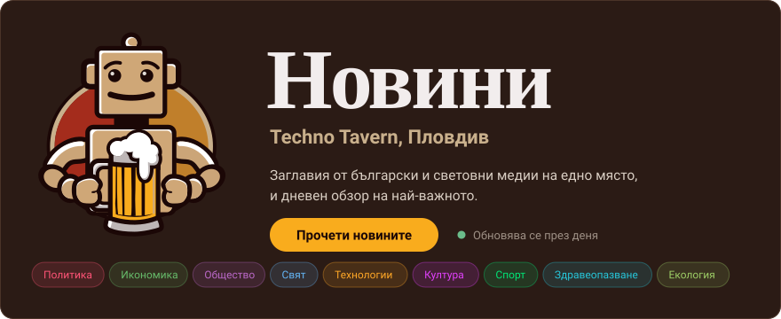

  

&nbsp;

**[Techno Tavern News](https://www.technotavern.com/news/)** is a news site I built for Plovdiv's social space, [Techno Tavern](https://www.technotavern.com). It collects headlines from Bulgarian and world media into one feed, sorts them by category, and writes a daily overview of the stories that matter.

I'm Mihail, a lead software developer in Sofia. I own front-end architecture and lead full-stack teams.

[Techno Tavern News](https://www.technotavern.com/news/) &nbsp;|&nbsp; [Resume](https://mihaildono.github.io/resume/) &nbsp;|&nbsp; [LinkedIn](https://www.linkedin.com/in/mihail-georgiev-lead) &nbsp;|&nbsp; [Email](mailto:mihaildono@gmail.com)
